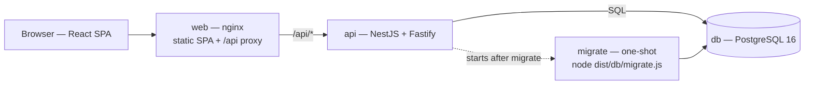
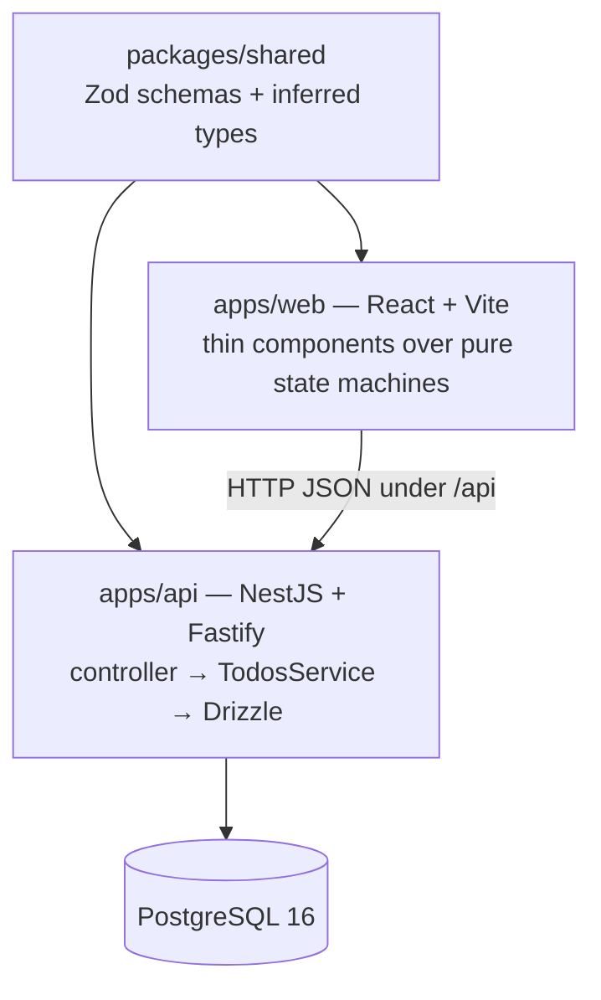

# TODO list

A single, shared TODO list with a NestJS + Fastify API, a React UI and
PostgreSQL, built as a pnpm-workspace monorepo. One list, no accounts —
concurrency is handled with optimistic versioning.

## Repository layout

```
apps/api          NestJS + Fastify API (Drizzle ORM, PostgreSQL, Zod, Swagger)
apps/web          React + Vite SPA (nginx in production)
packages/shared   Zod schemas + TypeScript types shared by both
docs/             ADRs, decision log, error catalog
CONTEXT.md        the domain glossary
Dockerfile        multi-stage build (development, build, api, web)
docker-compose.yml reviewer stack (db, migrate, api, web, seed)
```

## Architecture

One API image (serve-only), one nginx image for the SPA, one PostgreSQL
database; migrations are a separate one-shot job using the same API image.



`packages/shared` is the only thing the API and the web app share.



Requests are validated with the shared Zod schemas at the edge, and every failure
returns the one `{ code, message, … }` shape catalogued in
[`docs/errors.md`](./docs/errors.md). The load-bearing decisions live in
[`docs/adr`](./docs/adr) and [`docs/decision-log.md`](./docs/decision-log.md).

## Run it (Docker only)

Reviewers need Docker and nothing else:

```bash
docker compose up --build
```

Then open:

| URL | Description |
| --- | --- |
| http://localhost:8080 | Web UI |
| http://localhost:8000/api/docs | Swagger / OpenAPI UI |
| http://localhost:8000/api/readyz | Readiness probe |

### How the services start

`docker compose up --build` starts them in order:

1. `db` — PostgreSQL (healthchecked).
2. `migrate` — a one-shot job that applies Drizzle migrations
   (`node dist/db/migrate.js`) and exits.
3. `api` — starts only once `migrate` has succeeded. It **only serves** and never
   migrates, so it is safe to scale to many replicas.
4. `web` — nginx, reverse-proxying `/api` to the API.

To run just the API and its database (no web): `docker compose up db migrate api`.

The API image is self-contained and can be run outside compose. Apply migrations
once with the same image, then start the server:

```bash
docker build --target api -t todo-list-api .
docker run --rm -e DATABASE_URL=... todo-list-api node dist/db/migrate.js
docker run --rm -p 8000:8000 -e DATABASE_URL=... todo-list-api
```

Own the migrations as a single deploy step (a job/task using the same image)
before rolling out the service — never from the app replicas.

To seed demo data:

```bash
docker compose --profile tools run --rm --build seed
```

`docker/initdb` also creates the separate `todo-list_test` database on first
start. Copy `.env.example` to `.env` to override any default (Postgres
credentials, `CORS_ORIGINS`, ports).

## Develop

The devcontainer (VS Code → **Reopen in Container**) provides Node, pnpm and
PostgreSQL (reachable as `db:5432` inside) and forwards ports 8000 and 5173. Then:

```bash
pnpm install
pnpm dev        # API on :8000 and web on :5173, both with hot reload
```

## Common scripts

```bash
pnpm build             # build every package
pnpm typecheck         # build shared, then type-check all packages
pnpm lint              # ESLint
pnpm format            # Prettier (write)
pnpm test              # integration tests against todo-list_test
pnpm --filter @todo-list/api test:scale    # seeded 10k scale suite (slow)
pnpm --filter @todo-list/api benchmark     # non-gating wall-clock benchmark

pnpm --filter @todo-list/api db:generate   # generate a Drizzle migration
pnpm --filter @todo-list/api db:migrate    # apply migrations (dev DB)
pnpm --filter @todo-list/api db:clean      # empty list, keep schema
pnpm --filter @todo-list/api seed          # seed the small demo set
pnpm --filter @todo-list/api seed:manual   # ~70 varied TODOs for manual testing (truncates)
```

## API

REST under `/api`, domain-named. Full request/response schemas are in Swagger at
`/api/docs`; the failure codes are catalogued in [`docs/errors.md`](./docs/errors.md).

| Method & path | Purpose |
| --- | --- |
| `POST /api/todos` | Create a TODO |
| `GET /api/todos` | List — filter (status, priority, due range, overdue, blocked), sort, keyset-paginate |
| `GET /api/todos/:id` | Get one TODO |
| `GET /api/todos/search?q=` | Search TODOs by name (dependency picker) |
| `PATCH /api/todos/:id` | Update fields (optimistic `version`) |
| `DELETE /api/todos/:id?version=` | Delete (permanent; removes edges; optimistic) |
| `POST /api/todos/:id/transitions` | Move through the Status lifecycle |
| `GET /api/todos/:id/transition-impact` | Preview the dependents a transition would cascade |
| `GET /api/todos/:id/next-occurrence-preview` | Preview the next Occurrence a completion schedules |
| `GET /api/todos/:id/delete-impact` | Preview the dependents a delete would unblock |
| `POST /api/todos/:id/dependencies` | Add a Dependency |
| `DELETE /api/todos/:id/dependencies/:dependencyId` | Remove a Dependency |

## Design notes

- **Recurrence** is instance-based with two modes (ADR 0007): *after completion*
  (a habit — the next date counts from when you finished) and *on a schedule* (a
  calendar obligation — a bounded RFC 5545 subset). Only completing the live
  Occurrence spawns the next one. See ADR 0001 and ADR 0007.
- **Dependencies** gate both starting and completing; blocking is computed on
  read, and the graph is kept acyclic by a reachability check on every edge
  mutation. See ADR 0002 and ADR 0003.
- **Deletion** is permanent to the user: the row is retained for audit only, and
  deleting a TODO removes its Dependency edges so dependents unblock. See ADR
  0005.
- **Concurrency:** optimistic `version`ing on every write to a TODO's fields —
  edit, transition and delete (a stale write is `409`); a
  graph-wide advisory lock serialises dependency-edge mutations (ADR 0003); and
  completing a recurring TODO spawns at most one successor, guarded by the
  version check, a `spawnedAt` marker and a partial unique index (ADR 0007).
  There is no row lock and no `SERIALIZABLE` transaction.

## Continuous integration

[`.github/workflows/ci.yml`](./.github/workflows/ci.yml) runs on every push and
pull request:

- install with a frozen lockfile, then lint, format check, typecheck and build;
- the full test suite and the 10k scale suite, against a PostgreSQL service;
- a Docker build of the `api` and `web` images.

## Documentation

- [`CONTEXT.md`](./CONTEXT.md) — the domain glossary; use its vocabulary.
- [`docs/adr`](./docs/adr) — the load-bearing decisions (`0001`–`0007`).
- [`docs/decision-log.md`](./docs/decision-log.md) — interpretations and cuts.
- [`docs/errors.md`](./docs/errors.md) — the error catalog.

## Demo Scripts

```bash
docker compose up --build -d
```

```bash
docker compose ps
```
### curated 5-row fixture
```bash
docker compose --profile tools run --rm seed
```
### 70-row fixture
```bash
docker compose --profile tools run --rm --build seed \
  pnpm --filter @todo-list/api seed:manual
```
### empty list, keep schema
```bash
docker compose --profile tools run --rm clean
```


| URL | What |
| --- | --- |
| http://localhost:8080 | Web UI |
| http://localhost:8000/api/docs | Swagger / OpenAPI |
| http://localhost:8000/api/readyz | Readiness probe |